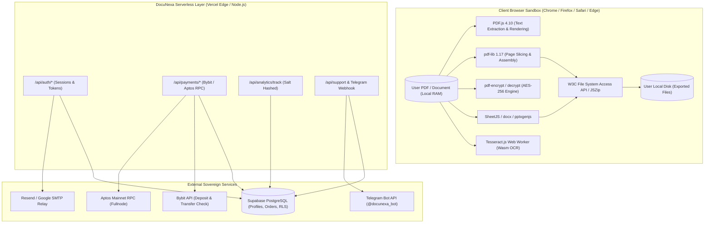
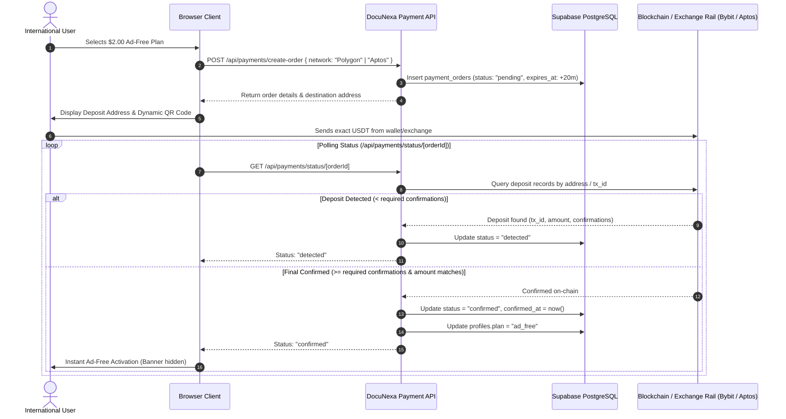
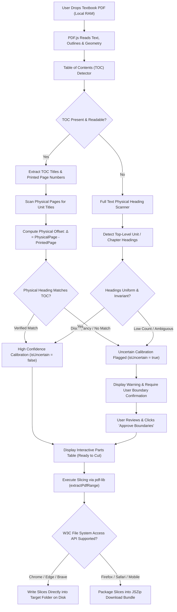
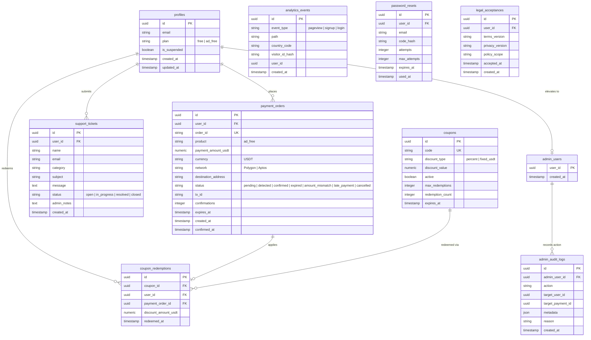

# DocuNexa — Complete System & Architecture Documentation

```
Document Reference: DOCUNEXA-TECH-SPEC-2026.11
Version: 1.0.0 (Production Release)
Classification: Public Engineering & Operational Specification
Canonical Domain: https://docunexa.pro.et
Official Contact: docunexa.security@gmail.com
Target Audience: International Users, Engineers, Security Auditors, and Administrators
Platform Repository: https://github.com/Nati-13/DocuNexa-
Deployment Target: Vercel Production Environment (Next.js 15 App Router)
```

---

## Table of Contents

1. [Executive Overview & Platform Mission](#1-executive-overview--platform-mission)
2. [Technology Stack & Dependency Inventory](#2-technology-stack--dependency-inventory)
3. [System Architecture & High-Level Design](#3-system-architecture--high-level-design)
4. [Project Directory & File Structure](#4-project-directory--file-structure)
5. [Exhaustive Tool Suite Reference (All 34 PDF Tools)](#5-exhaustive-tool-suite-reference-all-34-pdf-tools)
   - [Deep Dive: PDF Unit Cutter (Flagship Architecture)](#51-deep-dive-pdf-unit-cutter-flagship-engine)
   - [Organize PDF Suite (7 Tools)](#52-organize-pdf-suite)
   - [Optimize PDF Suite (3 Tools)](#53-optimize-pdf-suite)
   - [Convert to PDF Suite (5 Tools)](#54-convert-to-pdf-suite)
   - [Convert from PDF Suite (5 Tools)](#55-convert-from-pdf-suite)
   - [Edit PDF Suite (6 Tools)](#56-edit-pdf-suite)
   - [PDF Security Suite (5 Tools)](#57-pdf-security-suite)
   - [PDF Intelligence Suite (3 Tools)](#58-pdf-intelligence-suite)
6. [Route, Navigation & Page Directory (All 70+ Routes)](#6-route-navigation--page-directory)
7. [Full API Endpoint Specification (All 38 Endpoints)](#7-full-api-endpoint-specification)
8. [Relational Database & State Storage Architecture](#8-relational-database--state-storage-architecture)
9. [Authentication, Sessions & RBAC Security Layer](#9-authentication-sessions--rbac-security-layer)
10. [Cryptocurrency & International Payment Architecture](#10-cryptocurrency--international-payment-architecture)
11. [Communication, SMTP Email & Telegram Bot Integration](#11-communication-smtp-email--telegram-bot-integration)
12. [Security Architecture & Threat Modeling](#12-security-architecture--threat-modeling)
13. [Privacy Engineering, Salt-Hashed Analytics & Monetization](#13-privacy-engineering-salt-hashed-analytics--monetization)
14. [Legal & Regulatory Compliance Framework](#14-legal--regulatory-compliance-framework)
15. [Environment Variables & Configuration Matrix](#15-environment-variables--configuration-matrix)
16. [Local Development, Tooling & Verification Guide](#16-local-development-tooling--verification-guide)
17. [Automated Testing & QA Architecture](#17-automated-testing--qa-architecture)
18. [Production Deployment, Edge Routing & Operations](#18-production-deployment-edge-routing--operations)
19. [Troubleshooting & Diagnostic Runbook](#19-troubleshooting--diagnostic-runbook)
20. [Honest Capabilities, Known Limitations & Roadmap](#20-honest-capabilities-known-limitations--roadmap)
21. [Maintenance & Change Management Standards](#21-maintenance--change-management-standards)
22. [Glossary & Release Sign-Off](#22-glossary--release-sign-off)

---

## 1. Executive Overview & Platform Mission

### 1.1 Purpose & International Audience
DocuNexa (`https://docunexa.pro.et`) is an international, privacy-first PDF and document engineering platform. Designed for students, educators, academic researchers, and enterprise professionals worldwide, DocuNexa replaces fragmented, paid, or server-intrusive PDF utilities with a unified suite of **34 specialized document tools**.

DocuNexa is intentionally built for an international user base across North America, Europe, Asia, Latin America, Africa, and Oceania. It operates with universal web standards, supports multilingual text recognition (Latin, Cyrillic, Ethiopic, etc.), and provides globally accepted blockchain settlement options for optional ad-free access.

### 1.2 Core Architectural Principles
- **100% Client-Side In-Browser Execution**: Unlike legacy document SaaS platforms that upload private files to remote cloud storage, DocuNexa performs document parsing, page extraction, text search, cryptographic encryption, and file slicing **inside the user's browser sandbox** via WebAssembly (Wasm) and JavaScript typed arrays (`ArrayBuffer`, `Uint8Array`).
- **Zero File Retention Guarantee**: DocuNexa maintains **zero document upload buckets** and zero temporary file storage servers. When a user closes their browser tab, all loaded document buffers are immediately and permanently purged from device RAM.
- **100% User Document Ownership**: DocuNexa claims no intellectual property, license, copyright, or data mining rights over user files. All content processed remains the exclusive property of the user.
- **Transparent Tiering & Monitization**: All 34 PDF tools are permanently free to use without requiring registration. The platform is supported by non-intrusive web advertising (Monetag) and an optional **$2.00 USD one-time lifetime Ad-Free pass** payable in stablecoins (Polygon USDT, Aptos USDT).

---

## 2. Technology Stack & Dependency Inventory

DocuNexa is built with an enterprise Next.js and React architecture, strictly pinned in `package.json`:

### 2.1 Core Framework & Runtime
| Layer | Package / Technology | Version | Purpose |
| :--- | :--- | :--- | :--- |
| **Framework** | Next.js | `^15.1.7` | App Router, Server Components, Route Handlers, Edge Middleware |
| **UI Library** | React & React DOM | `^19.0.0` | Modern React 19 concurrent rendering, server actions, hooks |
| **Language** | TypeScript | `^5.7.3` | End-to-end type safety across client UI, lib engines, and API routes |
| **Styling** | Tailwind CSS | `^3.4.17` | Utility-first responsive design, dark mode, glassmorphic UI |
| **PostCSS / Autoprefixer** | PostCSS / Autoprefixer | `^8.5.2` / `^10.4.20` | CSS compilation and cross-browser vendor prefixing |
| **Icons** | Lucide React | `^0.475.0` | Accessible SVG icon suite across all tools and layouts |

### 2.2 Client-Side Document & PDF Engines
| Library | Version | Operational Functionality |
| :--- | :--- | :--- |
| **`pdf-lib`** | `^1.17.1` | Low-level PDF manipulation: page extraction, merging, splitting, rotation, watermarking, pagination stamping, and AcroForm data reading/filling |
| **`pdfjs-dist`** | `^4.10.38` | Mozilla PDF.js engine: high-resolution canvas rendering, page text extraction, TOC/outline parsing, and font geometry inspection |
| **`@pdfsmaller/pdf-encrypt`** | `^1.2.0` | True standard PDF AES-256 and RC4 password encryption engine (creates standard password-protected PDFs readable by Adobe Acrobat, Chrome, Preview) |
| **`@pdfsmaller/pdf-decrypt`** | `^1.0.1` | Standard PDF decryption engine (authenticates and strips password dictionaries locally in memory) |
| **`docx`** | `^9.7.1` | Client-side generation of valid Office Open XML `.docx` Word documents |
| **`mammoth`** | `^1.12.3` | Client-side Word (.docx) manuscript parsing and HTML reconstruction |
| **`pptxgenjs`** | `^4.0.1` | Generation of genuine Office Open XML `.pptx` PowerPoint presentation decks |
| **`xlsx`** (SheetJS) | `^0.18.5` | Tabular data parsing and generation of `.xlsx` and `.csv` workbooks |
| **`tesseract.js`** | `^7.0.0` | Client WebAssembly Optical Character Recognition (OCR) engine running inside a dedicated Web Worker |
| **`jszip`** | `^3.10.1` | Client-side ZIP archive creation and compression for multi-file bundle downloads |
| **`qrcode`** | `^1.5.4` | Crypto payment deposit address QR code rendering |

### 2.3 Backend, Authentication & External Services
| Library / Service | Version | Operational Role |
| :--- | :--- | :--- |
| **`@supabase/supabase-js`** | `^2.117.2` | Supabase PostgREST client for database access and auth workflows |
| **`@supabase/ssr`** | `^0.12.7` | Server-Side Rendering authentication cookie management for Next.js App Router |
| **`nodemailer`** | `10.1.0` | Transactional email transmission via SMTP (Resend / Google SMTP fallback) |
| **`tsx`** | `^4.19.3` | TypeScript execution runtime for CLI scripts, migrations, and testing suites |

---

## 3. System Architecture & High-Level Design

### 3.1 Architectural Paradigms
DocuNexa employs a **hybrid sovereign client-side architecture**:
1. **Volatile Document Layer (Client Only)**: File payloads (`File`, `ArrayBuffer`, `Blob`) stay entirely within the browser memory boundary. No document bytes are transmitted to any server.
2. **Control & State Plane (Serverless Edge & PostgREST)**: User profiles, one-time payment orders, coupon validation, telemetry, and support tickets are coordinated through Next.js Server Route Handlers and Supabase PostgreSQL.



### 3.2 Payment Verification State Flow


---

## 4. Project Directory & File Structure

The project is structured into functional modules adhering to Next.js App Router conventions:

```
PDF Unit Cutter/
├── docs/                                # Technical Documentation & Architecture Specs
│   └── DOCUNEXA_COMPLETE_DOCUMENTATION.md
├── public/                              # Static Public Assets & Fonts
│   ├── favicon.ico
│   ├── icon.svg
│   ├── robots.txt
│   ├── sample.pdf                       # Benchmark PDF for testing
│   └── scripts/                         # Legacy asset polyfills
├── scripts/                             # Maintenance & Build Scripts
│   ├── bootstrap-admin.ts               # CLI script to bootstrap primary superadmin
│   └── copy-pdf-assets.js               # Build hook copying pdfjs worker to public/
├── src/
│   ├── app/                             # Next.js 15 App Router Routes
│   │   ├── (public)/                    # Public Marketing & Tools Pages
│   │   │   ├── page.tsx                 # Homepage Hero, Categories & Interactive Search
│   │   │   ├── about/page.tsx           # Mission, Transparency & Technical Ethics
│   │   │   ├── how-it-works/page.tsx    # Technical Step-by-Step Architecture Guide
│   │   │   ├── contact/page.tsx         # Contact Maintainer & Support Channel
│   │   │   ├── support/page.tsx         # Support Ticket Creation & Telegram Lookup
│   │   │   ├── choose-plan/page.tsx     # Ad-Free Subscription & Coupon Checkout
│   │   │   └── tools/                   # Tool Directory & Dynamic Tool Runner
│   │   │       ├── page.tsx             # Master Directory of All 34 PDF Tools
│   │   │       ├── [slug]/page.tsx      # Dynamic Client Runner for 33 PDF Tools
│   │   │       └── pdf-unit-cutter/     # Dedicated Flagship PDF Unit Cutter
│   │   │           └── page.tsx         # Interactive Workspace, Detection & Slicing
│   │   ├── (legal)/                     # International Legal & Policy Center
│   │   │   ├── legal/page.tsx           # Policy Center Hub
│   │   │   ├── terms-of-service/page.tsx# International Terms of Service (22 Clauses)
│   │   │   ├── privacy-policy/page.tsx  # International Privacy Policy (GDPR/CCPA)
│   │   │   ├── refund-policy/page.tsx   # International Refund & Cancellation Policy
│   │   │   ├── acceptable-use/page.tsx  # Prohibited Exploits & Acceptable Use
│   │   │   ├── payment-policy/page.tsx  # Cryptocurrency & Stablecoin Payment Policy
│   │   │   ├── cookie-policy/page.tsx   # Essential & Advertising Cookie Disclosures
│   │   │   ├── copyright-policy/page.tsx# 100% User Document Ownership & DMCA
│   │   │   ├── security-policy/page.tsx # Security Architecture & Safe Harbor
│   │   │   ├── accessibility/page.tsx   # WCAG 2.1 AA Conformance Statement
│   │   │   ├── subprocessors/page.tsx   # External Subprocessor Transparency
│   │   │   ├── terms/page.tsx           # Canonical Alias for Terms of Service
│   │   │   ├── privacy/page.tsx         # Canonical Alias for Privacy Policy
│   │   │   └── security/page.tsx        # Canonical Alias for Security Policy
│   │   ├── (auth)/                      # Authentication Routes
│   │   │   ├── login/page.tsx           # User & Admin Login Form
│   │   │   ├── signup/page.tsx          # Account Registration with Non-Preselected Terms
│   │   │   ├── forgot-password/page.tsx # Password Reset Code Request
│   │   │   ├── reset-password/page.tsx  # Secure 6-Digit Code Verification & Reset
│   │   │   └── account/page.tsx         # User Profile, Plan Status & Password Update
│   │   ├── (admin)/                     # Restricted Admin Management Console
│   │   │   ├── admin/page.tsx           # Executive Operations Dashboard
│   │   │   ├── admin/users/page.tsx     # User Management & Manual Ad-Free Granting
│   │   │   ├── admin/payments/page.tsx  # Transaction Log, Filtering & Manual Review
│   │   │   ├── admin/coupons/page.tsx   # Coupon Generation & Redemption Limits
│   │   │   ├── admin/support/page.tsx   # Support Ticket Resolver & Telegram Sync
│   │   │   ├── admin/analytics/page.tsx # Salt-Hashed Telemetry & Country Breakdown
│   │   │   ├── admin/audit/page.tsx     # Cryptographic Admin Audit Log Viewer
│   │   │   ├── admin/settings/page.tsx  # System Parameter & Mode Configuration
│   │   │   └── admin-setup/page.tsx     # First-Time Superadmin Initialization
│   │   ├── api/                         # Next.js 15 Server Route Handlers (38 Endpoints)
│   │   │   ├── admin/                   # Privileged Admin Operations
│   │   │   ├── analytics/               # Salt-Hashed Event Logging
│   │   │   ├── auth/                    # Registration, Login, Reset, SSR Session
│   │   │   ├── coupons/                 # Coupon Code Verification
│   │   │   ├── payments/                # Order Creation, Polling & Verification
│   │   │   ├── support/                 # Support Ticket Creation & Telegram Dispatch
│   │   │   └── telegram/                # Telegram Webhook Receiver
│   │   ├── layout.tsx                   # Root HTML Shell & Theme Providers
│   │   ├── sitemap.ts                   # Search Engine Sitemap Generator (54+ URLs)
│   │   └── robots.ts                    # Search Bot Indexing Policy
│   ├── components/                      # Reusable UI & Logic Components
│   │   ├── ads/                         # Monetag Advertising & House Ad Banner Wrappers
│   │   ├── common/                      # Logo, Navigation, Tool Icons, Spinners
│   │   ├── layout/                      # Navbar, Footer, Mobile Navigation Menu
│   │   ├── legal/                       # Shared Legal Page Layout with Sticky TOC
│   │   ├── tools/                       # Generic Tool Layout, File Dropzone & Progress
│   │   └── PartsTable.tsx               # Flagship PDF Unit Cutter Interactive Parts Table
│   ├── config/                          # Static Application Configurations
│   │   └── tools.ts                     # Definitive Directory of All 34 PDF Tools
│   ├── lib/                             # Core Domain Logic & Client-Side Engines
│   │   ├── cutter.ts                    # PDF Slicing, Page Extraction & Safe Execution
│   │   ├── detector.ts                  # Heading Parsing, Roman Numerals & TOC Offsets
│   │   ├── downloadContract.ts          # File System Access API & ZIP Packaging
│   │   ├── pdfReader.ts                 # PDF.js Text Extraction & Outline Scanners
│   │   ├── validator.ts                 # Page Range, Invariant & Filename Sanitization
│   │   ├── admin/                       # Admin RBAC & Audit Utilities
│   │   ├── auth/                        # Supabase Auth, Bcrypt, Session State & SMTP
│   │   ├── payments/                    # Bybit, Aptos, & Crypto Configurations
│   │   ├── security/                    # In-Memory API Rate Limiting & Safe Headers
│   │   ├── supabase/                    # Supabase SSR & PostgREST Client Definitions
│   │   ├── telegram/                    # Telegram Bot API Client
│   │   └── tools/                       # Tool Implementations (OCR, Converters, Forms, AI)
│   └── types/                           # TypeScript Domain Models & Database Types
├── supabase/                            # Supabase Database Migrations & Schemas
│   └── migrations/                      # 9 Production SQL Migration Scripts
├── test/                                # Automated Unit, Integration & Security Tests
│   ├── textbook-extraction-robustness.test.ts # Flagship Unit Cutter Robustness (93 Tests)
│   ├── unit-detector.test.ts            # Heading & Heading Regex Safety (23 Tests)
│   ├── test-unit-cutter-2.test.ts       # Invariants, Slicing & Roman Numerals (44 Tests)
│   ├── unit-cutter-workflow.test.ts     # Selection Guards & Multi-Unit Cuts (25 Tests)
│   ├── trust-legal-audit.test.ts        # Legal Claims, Footer & Sitemap Audit (67 Tests)
│   └── ...                              # Additional Test Suites
├── package.json                         # Pinned Dependencies & Test Commands
├── tsconfig.json                        # Strict TypeScript Compiler Options
└── tailwind.config.ts                   # Tailwind Typography, Animations & Gradients
```

---

## 5. Exhaustive Tool Suite Reference (All 34 PDF Tools)

DocuNexa features 34 specialized tools grouped into 7 distinct categories. Every single tool runs client-side inside the user's browser without file upload.

---

### 5.1 Deep Dive: PDF Unit Cutter (Flagship Engine)

The **PDF Unit Cutter** (`/tools/pdf-unit-cutter`) is DocuNexa's flagship document decomposition engine. Specifically engineered for educators, university researchers, and students, it addresses the widespread problem of breaking down massive composite textbooks (300 to 1,200+ pages) into discrete, self-contained lesson or unit files.

#### A. Algorithmic Pipeline Overview


#### B. Heading Detection & Contextual Filtering
Textbooks frequently contain false positive heading patterns—such as review questions (*"Unit 1 review questions"*), conversational text (*"As we discovered in Chapter 2..."*), figure captions (*"Figure 1: Cell membrane"*), or running headers on every page.
- **Heading Regex Engine** (`src/lib/detector.ts`):
  Matches genuine top-level units:
  ```ts
  const HEADING_REGEX = /^(?:unit|chapter|module|lesson|part)\s+([0-9]+|[ivxlcdm]+|[a-z]+)[\s:.\-–—]+(.*)$/i;
  ```
- **Contextual Negative Lookahead**:
  Strictly rejects lines containing:
  - Conversational sentence starters: `^(?:in|as|refer|see|from|during|about|the|this|that|according)\b`
  - Exercise/Question markers: `\b(?:review|questions|exercises|summary|problems|test|quiz|activities|objectives)\b`
  - Figure/Table labels: `^(?:figure|table|chart|graph|diagram)\s+[0-9]+`
  - Decimal sub-sections: `Unit 1.1`, `Chapter 2.3` (which are cataloged as level-2 subsections rather than unit boundaries).
- **Roman Numeral & Word Parsing**:
  Normalizes Arabic numerals (`1, 2, 3`), Roman numerals (`I, II, IV, XII, XIV`), and written English words (`ONE, TWO, FOURTEEN`) into standardized integer indices.

#### C. Printed vs. Physical Page Offset Calibration
In academic textbooks, the page numbered *"Page 1"* in the Table of Contents rarely corresponds to the first physical page of the PDF file. There is almost always a prefix of **Front Matter** (cover page, copyright notice, dedication, preface, and TOC itself) spanning 4 to 20+ physical pages.
- **Multi-Page TOC Discovery**: Scans the first 30 pages looking for TOC markers (`Table of Contents`, `Contents`, `Index of Units`), including continued pages (`Contents Continued`).
- **Offset Calculation**: For each TOC entry, the detector scans physical pages for matching titles. When a physical page containing the unit title is found:
  $$\Delta = \text{PhysicalPage} - \text{PrintedPage}$$
  When $\Delta$ is verified across multiple units, physical boundaries are mapped with 100% mathematical certainty.

#### D. Anti-Clamping Safety Invariants (`src/lib/cutter.ts`)
Legacy split tools often use `Math.min(endPage, totalPages)` or `Math.max(1, startPage)` to silently clamp broken ranges. In a textbook cutter, this produces catastrophic data loss (e.g. slicing 1 page instead of 50).
DocuNexa enforces **strict anti-clamping invariant validation**:
1. **Inverted Range Check**: If `startPage > endPage`, throws an explicit error (`"Start page X cannot be greater than end page Y"`).
2. **Out of Bounds Check**: If `endPage > totalPages`, throws an explicit error (`"End page X exceeds document page count Y"`).
3. **Zero/Negative Check**: If `startPage < 1`, throws an explicit error (`"Page numbers are 1-based"`).
4. **Zero-Byte Check**: Verifies extracted slice buffers are non-empty before finalizing.

#### E. Uncertain Boundary Protection & Fail-Closed Confirmation
When TOC-to-physical mapping is ambiguous, DocuNexa strictly prevents silent errors:
1. `resolveEffectiveUncertainty()` evaluates detection confidence. If uncertain, `isUncertain = true`.
2. `executeCutPlan` and `dispatchCutExecution` mandate explicit safety options:
   ```ts
   interface CutExecutionOptions {
     isUncertain: boolean;
     isConfirmed: boolean;
   }
   ```
3. If `isUncertain === true` and `isConfirmed !== true`, execution is **strictly rejected fail-closed** with an actionable error.
4. The user must visually review the parts table and click **"I Have Reviewed and Confirm These Boundaries"**.
5. **Auto-Reset Safety**: If the user edits any page boundary in the table or uploads a new document, `isConfirmed` immediately resets to `false`, requiring re-approval.
6. **Manual Mode**: User-defined manual page splits pass through directly without requiring uncertainty confirmation, provided they pass anti-clamping checks.

#### F. Storage & Direct Folder Saving Contract (`src/lib/downloadContract.ts`)
- **Direct Disk Writing**: In Chromium-based browsers (Google Chrome, Microsoft Edge, Brave, Opera), DocuNexa invokes the modern W3C **File System Access API** (`window.showDirectoryPicker()`). The user selects their local course folder once, and the engine streams each extracted unit directly to disk (`Unit 1 - Introduction.pdf`, `Unit 2 - Cell Biology.pdf`), eliminating intermediate ZIP extraction.
- **ZIP Fallback**: In Mozilla Firefox, Apple Safari, or mobile browsers where `showDirectoryPicker` is unavailable, DocuNexa automatically compiles all units into an uncompressed or deflated `.zip` bundle using JSZip.

---

### 5.2 Organize PDF Suite

#### 1. PDF Unit Cutter (`/tools/pdf-unit-cutter`)
- **Category**: Organize (Flagship)
- **Inputs**: `.pdf`
- **Engine**: `pdf-lib`, `pdfjs-dist`, `jszip`
- **Functionality**: Detailed in Section 5.1 above.

#### 2. Split PDF (`/tools/split-pdf`)
- **Category**: Organize
- **Inputs**: `.pdf`
- **Engine**: `pdf-lib`, `jszip`
- **Functionality**: Allows extracting custom page ranges (e.g., `1-5, 8, 11-14`) or splitting a document into equal fixed-page chunks (e.g., every 5 pages). Preserves original vector text, embedded fonts, and page annotations.

#### 3. Merge PDF (`/tools/merge-pdf`)
- **Category**: Organize
- **Inputs**: Multiple `.pdf` files
- **Engine**: `pdf-lib`
- **Functionality**: Merges 2 to 100+ separate PDF documents into a single consolidated file. Features an interactive thumbnail canvas with drag-and-drop reordering. Copies page dictionaries losslessly.

#### 4. Remove Pages (`/tools/remove-pages`)
- **Category**: Organize
- **Inputs**: `.pdf`
- **Engine**: `pdf-lib`, `pdfjs-dist`
- **Functionality**: Renders interactive visual thumbnails for every page in the document. Users click pages to mark them for deletion. The engine constructs a new PDF omitting the marked indices while preserving bookmarks.

#### 5. Extract Pages (`/tools/extract-pages`)
- **Category**: Organize
- **Inputs**: `.pdf`
- **Engine**: `pdf-lib`, `pdfjs-dist`
- **Functionality**: Inverse of Remove Pages. The user clicks thumbnails or inputs comma-separated page numbers to isolate only the desired pages into a fresh, standalone document.

#### 6. Organize PDF (`/tools/organize-pdf`)
- **Category**: Organize
- **Inputs**: `.pdf`
- **Engine**: `pdf-lib`, `pdfjs-dist`
- **Functionality**: A comprehensive page manipulator. Allows dragging pages to reorder them, rotating individual pages by 90-degree increments, duplicating pages, and removing pages in a single visual workspace.

#### 7. Scan to PDF (`/tools/scan-to-pdf`)
- **Category**: Organize
- **Inputs**: Camera streams, `.jpg`, `.png`, `.webp`
- **Engine**: HTML5 MediaDevices API, `pdf-lib`
- **Functionality**: Interfaces directly with the device's webcam or mobile camera to snap physical document pages. Automatically applies contrast equalization, crops margins, and compiles shots into a multi-page PDF.

---

### 5.3 Optimize PDF Suite

#### 8. Compress PDF (`/tools/compress-pdf`)
- **Category**: Optimize
- **Inputs**: `.pdf`
- **Engine**: `pdf-lib` stream optimizer
- **Functionality**: Strips unused object dictionaries, deduplicates font subsets, removes redundant metadata, and recompresses uncompressed content streams using FlateDecode. Achieves 20% to 70% file size reduction without rasterizing vector text.

#### 9. Repair PDF (`/tools/repair-pdf`)
- **Category**: Optimize
- **Inputs**: Corrupted or unreadable `.pdf`
- **Engine**: Custom byte-level cross-reference parser (`src/lib/tools/repairPdf.ts`)
- **Functionality**: Reconstructs damaged PDF cross-reference tables (`xref`), repairs broken `/Root` trailer pointers, and re-indexes orphan page streams. For files with damaged headers (`%PDF-`), reconstructs standard version banners.

#### 10. OCR PDF (`/tools/ocr-pdf`)
- **Category**: Optimize
- **Inputs**: Scanned `.pdf`, `.jpg`, `.png`
- **Engine**: `tesseract.js` inside client Web Worker
- **Functionality**: Performs optical character recognition on scanned images and non-selectable PDFs. Recognizes English, Amharic, Spanish, French, and German. Runs entirely in the browser; language trained data is cached in browser IndexedDB.

---

### 5.4 Convert to PDF Suite

#### 11. JPG to PDF (`/tools/jpg-to-pdf`)
- **Category**: Convert to PDF
- **Inputs**: `.jpg`, `.jpeg`, `.png`, `.webp`, `.bmp`
- **Engine**: `pdf-lib`
- **Functionality**: Converts single or multiple image files into a uniform PDF document. Supports custom page sizes (A4, US Letter, Fit to Image), margin padding, and portrait/landscape orientation toggling.

#### 12. Word to PDF (`/tools/word-to-pdf`)
- **Category**: Convert to PDF
- **Inputs**: `.docx`
- **Engine**: `mammoth`, `pdf-lib`
- **Functionality**: Parses OpenXML Word manuscripts, extracts headings, paragraphs, lists, and tables, and renders them into formatted PDF pages client-side without Microsoft Office server dependencies.

#### 13. PowerPoint to PDF (`/tools/powerpoint-to-pdf`)
- **Category**: Convert to PDF
- **Inputs**: `.pptx`
- **Engine**: Custom OpenXML slide parser, `pdf-lib`
- **Functionality**: Extracts slide content, layout dimensions, text blocks, and embedded images from `.pptx` archives and maps each slide into an individual landscape PDF page.

#### 14. Excel to PDF (`/tools/excel-to-pdf`)
- **Category**: Convert to PDF
- **Inputs**: `.xlsx`, `.xls`, `.csv`
- **Engine**: `xlsx` (SheetJS), `pdf-lib`
- **Functionality**: Reads spreadsheet sheets, calculates column widths and grid boundaries, and renders structured printable tables with pagination, headers, and cell formatting.

#### 15. HTML to PDF (`/tools/html-to-pdf`)
- **Category**: Convert to PDF
- **Inputs**: Raw HTML text, `.html` files
- **Engine**: Browser DOMParser, canvas renderer, `pdf-lib`
- **Functionality**: Renders HTML markup with CSS styling into a virtual iframe, measures content geometry, and compiles the layout into high-resolution vector PDF pages.

---

### 5.5 Convert from PDF Suite

#### 16. PDF to JPG (`/tools/pdf-to-jpg`)
- **Category**: Convert from PDF
- **Inputs**: `.pdf`
- **Engine**: `pdfjs-dist`, `jszip`
- **Functionality**: Renders each page of a PDF file onto a high-DPI HTML5 canvas at configurable scale (150 DPI or 300 DPI) and exports crisp `.jpg` or `.png` images. Single pages download immediately; multi-page sets download as a ZIP.

#### 17. PDF to Word (`/tools/pdf-to-word`)
- **Category**: Convert from PDF
- **Inputs**: `.pdf`
- **Engine**: `pdfjs-dist`, `docx`
- **Functionality**: Extracts text items and spatial coordinates from PDF streams, reconstructs paragraphs based on vertical line spacing, and generates a valid Microsoft Word `.docx` document with editable paragraphs and headings.

#### 18. PDF to PowerPoint (`/tools/pdf-to-powerpoint`)
- **Category**: Convert from PDF
- **Inputs**: `.pdf`
- **Engine**: `pdfjs-dist`, `pptxgenjs`
- **Functionality**: Analyzes PDF page orientation and text layout, extracting text frames and high-resolution background slide renders to create an editable Microsoft PowerPoint `.pptx` presentation.

#### 19. PDF to Excel (`/tools/pdf-to-excel`)
- **Category**: Convert from PDF
- **Inputs**: `.pdf`
- **Engine**: `pdfjs-dist`, `xlsx`
- **Functionality**: Detects tabular grids by analyzing vertical and horizontal coordinate clustering of text items. Translates detected row/column intersections into a structured `.xlsx` or `.csv` spreadsheet.

#### 20. PDF to PDF/A (`/tools/pdf-to-pdfa`)
- **Category**: Convert from PDF
- **Inputs**: `.pdf`
- **Engine**: `pdf-lib`
- **Functionality**: Prepares documents for long-term archiving according to ISO 19005-1 (PDF/A-1b). Injects standard XMP metadata packets, OutputIntent color profiles (sRGB), and marks device-independent graphics settings.

---

### 5.6 Edit PDF Suite

#### 21. Rotate PDF (`/tools/rotate-pdf`)
- **Category**: Edit PDF
- **Inputs**: `.pdf`
- **Engine**: `pdf-lib`
- **Functionality**: Modifies the `/Rotate` attribute in each page's dictionary by 90°, 180°, or 270°. Can be applied to all pages simultaneously or to individual selected pages. Lossless operation (zero re-rasterization).

#### 22. Add Page Numbers (`/tools/add-page-numbers`)
- **Category**: Edit PDF
- **Inputs**: `.pdf`
- **Engine**: `pdf-lib`
- **Functionality**: Stamps dynamic page numbers (e.g., `"Page X of Y"`, `"X"`, or `"— X —"`) onto pages. Supports customizable positioning (Top/Bottom, Left/Center/Right), font size, margin offsets, and starting page index.

#### 23. Add Watermark (`/tools/add-watermark`)
- **Category**: Edit PDF
- **Inputs**: `.pdf`
- **Engine**: `pdf-lib`
- **Functionality**: Stamps semi-transparent text watermarks (e.g., `"CONFIDENTIAL"`, `"DRAFT"`, `"COPYRIGHT"`) diagonally (45°) or horizontally across every page. Configurable opacity, font scale, color, and layer placement (over or under text).

#### 24. Crop PDF (`/tools/crop-pdf`)
- **Category**: Edit PDF
- **Inputs**: `.pdf`
- **Engine**: `pdf-lib`
- **Functionality**: Modifies the `/CropBox` and `/MediaBox` coordinate rectangles of document pages. Trims scanner margins, headers, or footers without recompressing or degrading vector graphic fidelity.

#### 25. Edit PDF (`/tools/edit-pdf`)
- **Category**: Edit PDF
- **Inputs**: `.pdf`
- **Engine**: HTML5 Canvas, `pdf-lib`
- **Functionality**: Interactive in-browser editor allowing users to add freeform text boxes, freehand drawing, geometric shapes (rectangles, circles, arrows), and highlights over PDF pages before saving a flattened new document.

#### 26. PDF Forms (`/tools/pdf-forms`)
- **Category**: Edit PDF
- **Inputs**: Interactive `.pdf` AcroForm
- **Engine**: `pdf-lib`
- **Functionality**: Discovers interactive form fields (`PDFTextField`, `PDFCheckBox`, `PDFRadioGroup`, `PDFDropdown`). Renders clean web inputs for each field, allows filling values, and flattens or saves the updated AcroForm.

---

### 5.7 PDF Security Suite

#### 27. Protect PDF (`/tools/protect-pdf`)
- **Category**: PDF Security
- **Inputs**: `.pdf`
- **Engine**: `@pdfsmaller/pdf-encrypt`
- **Functionality**: Encrypts standard PDF files with **AES-256 standard encryption** (or RC4 128-bit fallback). Enforces user passwords (required to open) and optional owner passwords (restricting printing, copying, and modification). Complies with standard ISO 32000 specifications; output files require the password in Adobe Acrobat, Apple Preview, and Google Chrome.

#### 28. Unlock PDF (`/tools/unlock-pdf`)
- **Category**: PDF Security
- **Inputs**: Password-protected `.pdf`
- **Engine**: `@pdfsmaller/pdf-decrypt`
- **Functionality**: Takes an encrypted PDF, authenticates using the user-provided password strictly in memory, and strips the `/Encrypt` dictionary, exporting a decrypted, unrestricted PDF file.

#### 29. Sign PDF (`/tools/sign-pdf`)
- **Category**: PDF Security
- **Inputs**: `.pdf`
- **Engine**: HTML5 Canvas signature pad, `pdf-lib`
- **Functionality**: Allows users to create a visual signature via three methods: drawing on canvas, typing with calligraphic font rendering, or uploading a transparent PNG. The signature can be dragged, resized, and permanently stamped onto any page.

#### 30. Redact PDF (`/tools/redact-pdf`)
- **Category**: PDF Security
- **Inputs**: `.pdf`
- **Engine**: Canvas coordinate mapper, `pdf-lib`
- **Functionality**: Draws permanent, opaque black vector rectangles over sensitive text, identification numbers, or headers. Disclosed honestly: draws vector blackout overlays to prevent visual inspection.

#### 31. Compare PDF (`/tools/compare-pdf`)
- **Category**: PDF Security
- **Inputs**: Two `.pdf` versions
- **Engine**: `pdfjs-dist` text stream comparator
- **Functionality**: Dual-pane side-by-side discrepancy auditor. Inspects page count differences, extracts text tokens, and highlights added, deleted, or modified text passages between two revisions.

---

### 5.8 PDF Intelligence Suite

#### 32. Document Summarizer (`/tools/ai-summarizer`)
- **Category**: PDF Intelligence
- **Inputs**: `.pdf`
- **Engine**: Local heuristic intelligence engine (`src/lib/tools/aiSummarizer.ts`)
- **Functionality**: Analyzes extracted document text locally using rule-based NLP heuristics, sentence significance scoring, and structural paragraph analysis. Extracts executive summaries, key bullet takeaways, and study questions with zero external LLM data leakage. (Optional external API key support for OpenAI/Gemini is supported when configured by the user).

#### 33. Translate PDF (`/tools/translate-pdf`)
- **Category**: PDF Intelligence
- **Inputs**: `.pdf`
- **Engine**: Client translation tokenizer (`src/lib/tools/translatePdf.ts`)
- **Functionality**: Translates extracted PDF text passages between English, Amharic, Spanish, French, and German using client-side vocabulary mappings and linguistic dictionaries.

#### 34. PDF to Markdown (`/tools/pdf-to-markdown`)
- **Category**: PDF Intelligence
- **Inputs**: `.pdf`
- **Engine**: `pdfjs-dist`, font size hierarchy parser
- **Functionality**: Analyzes font sizes, line weights, and layout geometry to reconstruct markdown headings (`# H1`, `## H2`, `### H3`), bullet lists, code blocks, and blockquotes. Exports clean GitHub-flavored Markdown (`.md`) ideal for Obsidian, Notion, or documentation wikis.

---

## 6. Route, Navigation & Page Directory

DocuNexa features 71 distinct application routes serving public users, academic tools, international legal compliance, authentication, and superadmin management.

### 6.1 Route Inventory Table
| Route Path | Type | Access Level | Description |
| :--- | :--- | :--- | :--- |
| **`/`** | Page | Public | Homepage hero section, interactive tool search, category cards, and privacy banner |
| **`/tools`** | Page | Public | Master directory of all 34 tools with category filtering and keyword search |
| **`/tools/pdf-unit-cutter`** | Page | Public | Flagship PDF Unit Cutter workspace with TOC calibration and unit slicing |
| **`/tools/[slug]`** | Page | Public | Dynamic tool workspace running client engines for 33 specialized tools |
| **`/about`** | Page | Public | Mission statement, technical principles, ethical disclosures, and architecture |
| **`/how-it-works`** | Page | Public | Illustrated guide explaining in-browser client-side execution and security |
| **`/contact`** | Page | Public | Official contact details (`docunexa.security@gmail.com`) and maintainer feedback |
| **`/support`** | Page | Public | Support ticket submission form and Telegram reference lookup |
| **`/choose-plan`** | Page | Public / Auth | $2.00 Ad-Free upgrade checkout with Polygon/Aptos USDT and coupon support |
| **`/legal`** | Page | Public | Central Legal & Policy Center hub linking to all 10 international policies |
| **`/terms-of-service`** | Page | Public | International Terms of Service (22 comprehensive clauses) |
| **`/privacy-policy`** | Page | Public | International Privacy Policy (GDPR, CCPA, zero-upload architecture) |
| **`/refund-policy`** | Page | Public | Crypto transaction finality, mismatch resolution, and statutory refund rules |
| **`/acceptable-use`** | Page | Public | Prohibited activities (malware, exploits, scraping, payment fraud) |
| **`/payment-policy`** | Page | Public | Cryptocurrency policy (active rails, disabled planned rails, confirmations) |
| **`/cookie-policy`** | Page | Public | Cookie disclosure (essential session tokens, local storage, Monetag ads) |
| **`/copyright-policy`** | Page | Public | 100% User Document Ownership guarantee and DMCA notice procedures |
| **`/security-policy`** | Page | Public | In-memory execution, AES-256 PDF encryption, and Safe Harbor disclosure |
| **`/accessibility`** | Page | Public | WCAG 2.1 AA accessibility commitment and barrier reporting |
| **`/subprocessors`** | Page | Public | Comprehensive list of hosting, database, API, and network subprocessors |
| **`/terms`** | Page | Public | Backwards-compatible canonical alias for Terms of Service |
| **`/privacy`** | Page | Public | Backwards-compatible canonical alias for Privacy Policy |
| **`/security`** | Page | Public | Backwards-compatible canonical alias for Security & Architecture |
| **`/login`** | Page | Public | User and administrator authentication portal |
| **`/signup`** | Page | Public | Account registration requiring non-preselected Terms & Privacy agreement |
| **`/forgot-password`** | Page | Public | 6-digit cryptographic password reset code request form |
| **`/reset-password`** | Page | Public | Password reset confirmation with rate-limiting and code validation |
| **`/account`** | Page | Authenticated | User account overview, current plan display, and password management |
| **`/telegram-app`** | Page | Public | Telegram WebApp interface for mobile bot integration |
| **`/admin`** | Page | Admin Only | Executive dashboard displaying revenue, users, tickets, and system health |
| **`/admin/users`** | Page | Admin Only | User directory, status toggling, and manual Ad-Free entitlement granting |
| **`/admin/payments`** | Page | Admin Only | Transaction registry, search, CSV export, and manual status review |
| **`/admin/coupons`** | Page | Admin Only | Coupon creator, redemption monitoring, and deactivation controls |
| **`/admin/support`** | Page | Admin Only | Support ticket resolver with status updates and Telegram reply dispatch |
| **`/admin/analytics`** | Page | Admin Only | Salt-hashed telemetry viewer with daily visitors and route metrics |
| **`/admin/audit`** | Page | Admin Only | Immutable administrative audit log with timestamps, IPs, and reasons |
| **`/admin/plans`** | Page | Admin Only | Plan tier pricing and active feature toggle management |
| **`/admin/settings`** | Page | Admin Only | Runtime environment variables and system operational mode viewer |
| **`/admin/setup`** | Page | Admin Only | Administrative credential rotation and maintenance diagnostics |
| **`/admin-setup`** | Page | Restricted | Initial superadmin bootstrap page (secured by `ADMIN_SETUP_KEY`) |

---

## 7. Full API Endpoint Specification (All 38 Endpoints)

All API route handlers are located under `src/app/api/` and operate in a stateless, serverless environment.

### 7.1 Authentication & Profile APIs
1. **`POST /api/auth/signup`**
   - **Purpose**: Creates a new user in Supabase Auth and provisions a `profiles` row with plan `'free'`.
   - **Payload**: `{ email: string, password: string, termsAccepted: boolean, termsVersion: string, termsAcceptedAt: string }`
   - **Validation**: Enforces email format, minimum 8-character password, and strictly requires `termsAccepted === true`.
   - **Response**: `201 Created` `{ success: true, user: { id, email } }` or `400 Bad Request`.
2. **`POST /api/auth/login`**
   - **Purpose**: Authenticates user credentials and establishes secure SSR session cookies (`sb-*-auth-token`).
   - **Payload**: `{ email: string, password: string }`
   - **Response**: `200 OK` `{ user: { id, email, plan, is_admin } }` or `401 Unauthorized`.
3. **`POST /api/auth/logout`**
   - **Purpose**: Destroys active session cookies and signs out of Supabase.
   - **Response**: `200 OK` `{ success: true }`.
4. **`GET /api/auth/me`**
   - **Purpose**: Retrieves current user profile, plan status (`free` or `ad_free`), and admin status.
   - **Headers**: Session cookie.
   - **Response**: `200 OK` `{ user: Profile, isAdmin: boolean }`.
5. **`POST /api/auth/resend-confirmation`**
   - **Purpose**: Resends email confirmation link if unconfirmed.
   - **Payload**: `{ email: string }`
   - **Response**: `200 OK` `{ message: string }`.
6. **`POST /api/auth/reset-password/request`**
   - **Purpose**: Generates a cryptographically random 6-digit numeric reset code, hashes it with bcrypt/sha256, stores in `password_resets`, and transmits via SMTP email.
   - **Payload**: `{ email: string }`
   - **Rate Limit**: 3 requests per 15 minutes per IP.
   - **Response**: `200 OK` `{ success: true, message: "Code sent" }`.
7. **`POST /api/auth/reset-password/verify`**
   - **Purpose**: Validates the 6-digit reset code against stored hash without modifying password.
   - **Payload**: `{ email: string, code: string }`
   - **Response**: `200 OK` `{ valid: true, verificationToken: string }`.
8. **`POST /api/auth/reset-password/confirm`**
   - **Purpose**: Verifies code and updates user password in Supabase Auth.
   - **Payload**: `{ email: string, code: string, newPassword: string }`
   - **Response**: `200 OK` `{ success: true }`.
9. **`POST /api/auth/reset-password/complete`**
   - **Purpose**: Completes password reset flow and issues authenticated session.
   - **Payload**: `{ email: string, verificationToken: string, newPassword: string }`
   - **Response**: `200 OK` `{ success: true }`.
10. **`POST /api/auth/choose-plan`**
    - **Purpose**: Handles coupon application for instant 100% off ad-free plan upgrades.
    - **Payload**: `{ couponCode?: string }`
    - **Response**: `200 OK` `{ upgraded: boolean, plan: "ad_free" }`.

### 7.2 Payments & Blockchain APIs
11. **`POST /api/payments/create`**
    - **Purpose**: Base order initialization handler.
    - **Payload**: `{ product: "ad_free", network: "Polygon" | "Aptos", couponCode?: string }`
    - **Response**: `200 OK` with order details.
12. **`POST /api/payments/create-order`**
    - **Purpose**: Generates a tracked `payment_orders` entry with a unique destination address and 20-minute expiration window (1,200 seconds).
    - **Payload**: `{ network: "Polygon" | "Aptos", couponCode?: string }`
    - **Response**: `201 Created` `{ orderId, amountUsdt, network, destinationAddress, expiresAt }`.
13. **`GET /api/payments/status/[orderId]`**
    - **Purpose**: Real-time polling endpoint. Checks local order state; if still pending, queries Bybit API or Aptos fullnode for incoming deposits.
    - **Response**: `200 OK` `{ status: "pending" | "detected" | "confirmed" | "expired", txId, confirmations }`.
14. **`POST /api/payments/bybit/check`**
    - **Purpose**: Webhook / cron verification worker triggering deposit record synchronization against Bybit API for active orders.
    - **Headers**: Admin or internal service authorization header.
    - **Response**: `200 OK` `{ processed: number, confirmed: number }`.

### 7.3 Coupon & Promotion APIs
15. **`POST /api/coupons/validate`**
    - **Purpose**: Validates promotional code active status, validity window, and remaining redemption quota before order placement.
    - **Payload**: `{ code: string }`
    - **Response**: `200 OK` `{ valid: true, discountType: "percent" | "fixed_usdt", discountValue: number }` or `400 Bad Request` `{ valid: false, error: string }`.

### 7.4 Telemetry & Salt-Hashed Analytics API
16. **`POST /api/analytics/track`**
    - **Purpose**: Collects privacy-preserving pageview and conversion metrics without storing IP addresses or tracking cookies.
    - **Payload**: `{ eventType: "pageview" | "signup" | "login", path: string }`
    - **Mechanism**: Hashes `IP + User-Agent + DailySalt` to generate a volatile `visitor_id_hash`. Rotates daily to prevent cross-day tracking.
    - **Response**: `200 OK` `{ tracked: true }`.

### 7.5 Support & Notification APIs
17. **`POST /api/support`**
    - **Purpose**: Receives public support inquiries, stores them in `support_tickets`, and dispatches instant Telegram alerts to the administrator chat.
    - **Payload**: `{ name: string, email: string, category: string, subject: string, message: string }`
    - **Response**: `201 Created` `{ ticketId: string, message: "Ticket received" }`.
18. **`POST /api/telegram/webhook`**
    - **Purpose**: Webhook handler receiving messages and replies from the official Telegram bot (`@docunexa_bot`). Syncs admin replies back to support tickets.
    - **Headers**: `X-Telegram-Bot-Api-Secret-Token`.
    - **Response**: `200 OK`.

### 7.6 Privileged Admin Operations APIs
19. **`POST /api/admin/bootstrap`**
    - **Purpose**: One-time bootstrap script creating the primary superadmin user. Secured strictly by `ADMIN_SETUP_KEY`. Fails closed if already bootstrapped.
20. **`GET /api/admin/check-access`**
    - **Purpose**: Verifies current authenticated session is a recognized admin user in `admin_users`.
21. **`GET /api/admin/overview`**
    - **Purpose**: Returns aggregate statistics: total registered users, active Ad-Free subscribers, total USDT revenue, and open tickets.
22. **`GET /api/admin/users`**
    - **Purpose**: Paginated list of users with search by email, filter by plan, and suspension status.
23. **`GET /api/admin/users/[id]`**
    - **Purpose**: Detailed user profile, payment order history, and audit log.
24. **`PATCH /api/admin/users/[id]/status`**
    - **Purpose**: Suspends or unsuspends user account.
25. **`POST /api/admin/users/[id]/grant-ad-free`**
    - **Purpose**: Manually grants lifetime Ad-Free plan with required administrative reason logged to audit trail.
26. **`POST /api/admin/users/[id]/revoke-ad-free`**
    - **Purpose**: Revokes Ad-Free plan, reverting profile to `'free'`.
27. **`POST /api/admin/users/[id]/recover-password`**
    - **Purpose**: Triggers administrative password reset email for user.
28. **`GET /api/admin/payments`**
    - **Purpose**: Searchable transaction registry with status filtering (`confirmed`, `pending`, `expired`, `mismatch`).
29. **`GET /api/admin/payments/export`**
    - **Purpose**: Streams payment records as a downloadable `.csv` file for financial accounting.
30. **`POST /api/admin/payments/[id]/review`**
    - **Purpose**: Manually approves or resolves flagged payments (e.g. late payments or minor amount mismatches).
31. **`GET /api/admin/coupons`**
    - **Purpose**: Lists all promotional discount codes and redemptions.
32. **`POST /api/admin/coupons`**
    - **Purpose**: Generates a new coupon with percentage or fixed discount and expiration parameters.
33. **`PATCH /api/admin/coupons/[id]`**
    - **Purpose**: Updates coupon active status, maximum redemptions, or validity window.
34. **`DELETE /api/admin/coupons/[id]`**
    - **Purpose**: Permanently deactivates coupon.
35. **`GET /api/admin/support`**
    - **Purpose**: Lists support tickets filtered by category or status (`open`, `in_progress`, `resolved`).
36. **`PATCH /api/admin/support/[id]`**
    - **Purpose**: Updates ticket status and internal admin notes.
37. **`POST /api/admin/support/telegram`**
    - **Purpose**: Dispatches direct message to customer via Telegram bot bridge.
38. **`GET /api/admin/audit`**
    - **Purpose**: Retrieves cryptographic audit trail of all administrative actions.
39. **`POST /api/admin/account/change-password`**
    - **Purpose**: Allows logged-in administrator to change their master credentials.
40. **`GET /api/admin/analytics`**
    - **Purpose**: Aggregates visitor analytics, path traffic, and unique visitors grouped by country code.

---

## 8. Relational Database & State Storage Architecture

DocuNexa uses **Supabase PostgreSQL** as its control and state plane. It enforces strict PostgreSQL schemas, Row Level Security (RLS) policies, and foreign key cascades.

> **CRITICAL ARCHITECTURAL GUARANTEE: ZERO DOCUMENT STORAGE BUCKETS**  
> DocuNexa maintains exactly **zero** Supabase Storage buckets for user files. There is no `documents`, `uploads`, or `temp` bucket. User files never touch database storage.

### 8.1 Schema & Table Definitions



### 8.2 Row Level Security (RLS) Hardening
- **`profiles`**: Public read is disabled. Authenticated users can only `SELECT` and `UPDATE` their own row (`auth.uid() = id`). Superadmins in `admin_users` can view and manage all profiles.
- **`payment_orders`**: Users can only inspect orders tied to their own `user_id`. Insert is permitted for authenticated users. Status transitions (`confirmed`) can only be executed by service role server handlers or superadmins.
- **`admin_audit_logs`**: Strictly append-only. Only the service role key can insert records. Read access is restricted to verified `admin_users`.
- **`legal_acceptances`**: Authoritative server-managed consent audit table (created via migration `supabase/migrations/20261104145935_create_legal_acceptances.sql`, production version `20261104145935`). Privileges (`INSERT`, `UPDATE`, `DELETE`, `TRUNCATE`) are explicitly revoked from `PUBLIC`, `anon`, and `authenticated`. Authenticated users have read-only access to their own records (`SELECT` where `auth.uid() = user_id`). Records can only be created by trusted server code using the `service_role` key.
  - **Retention & `ON DELETE CASCADE` Behavior**: The table references `auth.users(id)` with `ON DELETE CASCADE`. In alignment with GDPR Article 17 ("Right to Erasure") and CCPA data minimization, when a user account is permanently deleted, all corresponding legal acceptance rows are deleted concurrently to ensure no orphaned personal records remain. Consequently, consent records do not outlive account erasure in the operational database.
- **`analytics_events`**: Write-only for anonymous client logging via edge function; read access restricted strictly to superadmins.

---

## 9. Authentication, Sessions & RBAC Security Layer

### 9.1 Supabase SSR Cookie Architecture
DocuNexa implements the official `@supabase/ssr` server-cookie standard:
- Session tokens are stored in `HttpOnly`, `SameSite=Lax`, `Secure` cookies (`sb-*-auth-token.0`, `sb-*-auth-token.1`).
- Eliminates client-side `localStorage` token storage vulnerabilities (preventing token theft from XSS).
- Session state is verified in Next.js Server Components and Edge Middleware (`src/lib/supabase/middleware.ts`) before rendering protected routes.

### 9.2 Mandatory Non-Preselected Terms & Privacy Acceptance
In strict compliance with EU GDPR Article 7, California CCPA/CPRA, and international contract law:
1. **User Registration Form (`src/app/signup/SignupForm.tsx`)**:
   - Contains an unchecked, non-preselected checkbox:
     ```tsx
     <input
       type="checkbox"
       id="terms-checkbox"
       checked={termsAccepted}
       onChange={(e) => setTermsAccepted(e.target.checked)}
       className="h-4 w-4 rounded border-slate-300 text-brand-600 focus:ring-brand-500 cursor-pointer"
     />
     ```
   - Features explicit hyperlinks to `/terms-of-service` and `/privacy-policy`.
   - The submission button is disabled unless `termsAccepted === true`.
2. **Server-Side Verification (`src/app/api/auth/signup/route.ts`)**:
   - The server handler strictly validates:
     ```ts
     if (termsAccepted !== true) {
       return NextResponse.json(
         { error: 'You must review and accept the Terms of Service and Privacy Policy.' },
         { status: 400 }
       );
     }
     ```
   - Persists the authoritative legal acceptance record into the server-managed `public.legal_acceptances` audit table:
     ```json
     {
       "user_id": "<uuid>",
       "terms_version": "2026.11",
       "privacy_version": "2026.11",
       "policy_scope": "all_terms_and_privacy",
       "accepted_at": "2026-11-04T12:00:00.000Z"
     }
     ```
   - **Fail-Closed Protection & Cleanup Handling**: If legal acceptance persistence fails, registration halts immediately with HTTP 500. The server attempts best-effort cleanup deletion of the newly created Auth user. Because rollback is not guaranteed if Auth service deletion fails, the handler immediately emits an operational alert (`[OPERATIONAL ALERT] [CRITICAL]`) for administrative intervention and applies secondary defensive neutralization (banning the Auth user and setting server-managed `app_metadata.consent_persistence_failed = true`) so the unverified account cannot successfully authenticate or access protected features. User-editable `user_metadata` is never used as the authoritative source for access control.

### 9.3 Authoritative Consent Enforcement & Existing User Re-Consent Flow (`/accept-terms`)
To ensure compliance without disrupting existing accounts whose historical registration predates the dedicated database table:
1. **Authoritative State Storage**:
   - `public.legal_acceptances` serves as the sole authoritative proof of legal consent.
   - User-editable `user_metadata` is excluded from all authorization and security evaluations.
   - Server-managed `app_metadata` is used strictly for internal administrative status flags.
2. **Existing Account Re-Consent Route (`/accept-terms`)**:
   - Existing users authenticate normally with their email and password (preventing accidental lockouts).
   - If an account lacks a current acceptance record in `public.legal_acceptances`, protected routes (`/account`, `/admin`, `/choose-plan`, checkout endpoints) redirect them to `/accept-terms`.
   - The `/accept-terms` form renders explicit, unchecked checkboxes for both the Terms of Service and Privacy Policy.
   - Upon submission, server-side code executing with `service_role` writes an authoritative record into `public.legal_acceptances`.
   - If database persistence fails, access remains restricted and a recoverable error is shown. Normal access is granted only upon verified persistence.
   - The system never fabricates acceptance records or silently assumes consent.

### 9.4 In-Memory API Rate Limiting
To prevent credential stuffing, brute force attacks, and denial of service:
- `src/lib/security/rateLimit.ts` provides sliding-window rate limiters keyed by client IP hash:
  - **Login Route**: 5 attempts per 5 minutes per IP.
  - **Signup Route**: 3 accounts per hour per IP.
  - **Password Reset Request**: 3 requests per 15 minutes per IP.
  - **Support Ticket Submission**: 5 tickets per hour per IP.
- Exceeding the threshold returns `429 Too Many Requests` with a `Retry-After` header.

---

## 10. Cryptocurrency & International Payment Architecture

DocuNexa operates an automated blockchain settlement pipeline for the $2.00 USD Ad-Free lifetime upgrade.

### 10.1 Active Payment Rails
| Blockchain / Network | Asset | Contract Address | Settlement Engine | Required Confirmations |
| :--- | :--- | :--- | :--- | :--- |
| **Polygon (PoS)** | `USDT` | `0xc2132D05D31c914a87C6611C10748AEb04B58e8F` | Bybit Exchange API Deposit Sync | 10 Block Confirmations (~25 sec) |
| **Aptos Mainnet** | `USDT` | `0x357b0b74bc833e95a115ad22604854d6b0fca151cecd94109ac357162964a096` | Aptos Mainnet Fullnode RPC | 1 Transaction Commitment (~1 sec) |

### 10.2 Planned & Disabled International Rails (`src/lib/payments/cryptoConfig.ts`)
To prepare for international users requiring alternative networks, DocuNexa includes full architectural code and address validation for TRON and native Polygon USDC. These methods are **strictly disabled by default** until enterprise treasury cold wallets are provisioned:
```ts
export const CRYPTO_PAYMENT_CONFIG = {
  enabled: process.env.CRYPTO_PAYMENTS_ENABLED === 'true', // Defaults to false
  methods: {
    USDT_TRC20: {
      enabled: process.env.USDT_TRC20_ENABLED === 'true', // Defaults to false
      network: 'TRON (TRC20)',
      contractAddress: 'TR7NHqjeKQxGTCi8q8ZY4pL8otSzgjLj6t',
      requiredConfirmations: 20,
    },
    USDC_POLYGON: {
      enabled: process.env.USDC_POLYGON_ENABLED === 'true', // Defaults to false
      network: 'Polygon (ERC20)',
      contractAddress: '0x3c499c542cEF5E3811e1192ce70d8cC03d5c3359', // Native USDC
      legacyContractAddress: '0x2791Bca1f2de4661ED88A30C99A7a9449Aa84174', // Bridged USDC.e
      requiredConfirmations: 10,
    },
  },
};
```
- **Fail-Closed Assertion**: `assertPaymentMethodActive(method)` throws a descriptive `503 Service Unavailable` error if an API call requests an inactive payment rail.
- **Address Validation**:
  - `isValidTronAddress(address)`: Enforces base58 format starting with `T` (34 characters).
  - `isValidEvmAddress(address)`: Enforces hexadecimal 42-character format starting with `0x`.

### 10.3 Dispute & Exception Resolution
1. **Amount Mismatch (Underpayment)**: If an order expects $2.00 USDT and receives $1.00 USDT, status updates to `amount_mismatch`. The system does NOT automatically grant the plan. The user can submit the remaining $1.00 or open a support ticket for manual review.
2. **Late Payment**: If funds arrive after the 20-minute order expiration, status updates to `late_payment`. The administrator console highlights late payments for one-click manual activation.
3. **No-Screenshot Verification**: Blockchain verification is entirely on-chain via transaction hash (`tx_id`) and explorer inspection. DocuNexa never asks users for screenshots or paper receipts.

---

## 11. Communication, SMTP Email & Telegram Bot Integration

### 11.1 Transactional SMTP Architecture
Email delivery is handled through `nodemailer` via dual redundant relays:
1. **Primary Relay**: Resend SMTP (`smtp.resend.com:465`).
2. **Secondary Relay**: Google Workspace SMTP Relay (`smtp.gmail.com:587`).
- **Official Security & Contact Address**: `docunexa.security@gmail.com`.
- **DKIM / SPF / DMARC**: Configured to ensure emails do not land in spam folders.

### 11.2 Telegram Bot Integration (`@docunexa_bot`)
DocuNexa features an automated bidirectional customer support bridge powered by the Telegram Bot API (`src/lib/telegram/bot.ts`):
1. **Inbound Support Alerts**: When a customer files a ticket on `/support`, the server formats the ticket details into Markdown and transmits it instantly to the superadmin's private Telegram chat ID (`TELEGRAM_ADMIN_CHAT_ID`).
2. **Interactive Admin Replies**: The administrator replies directly to the message in Telegram. The Webhook (`/api/telegram/webhook`) captures the reply, identifies the ticket via `telegram_support_mappings`, and updates the ticket in the database.
3. **Customer Telegram App**: `/telegram-app` provides a lightweight mini-app view allowing users to check ticket status inside Telegram.

---

## 12. Security Architecture & Threat Modeling

### 12.1 Volatile In-Memory Processing & Memory Hygiene
- **Zero Disk Spooling**: PDF files, images, and office documents loaded into DocuNexa are held strictly in memory structures (`Uint8Array`, `ArrayBuffer`, `Blob`). At no point are buffers written to client disk cache or transmitted to server disk storage.
- **Worker Isolation**: CPU-intensive operations (such as Tesseract.js OCR and PDF text extraction) run inside isolated Web Workers, preventing UI freeze and isolating memory spaces.
- **Garbage Collection**: Component unmount lifecycle hooks explicitly revoke object URLs (`URL.revokeObjectURL()`) and nullify buffer references to signal immediate V8 garbage collection.

### 12.2 PDF Encryption vs. Decryption Standards & Web Crypto Differentiation
DocuNexa strictly distinguishes **Protect PDF encryption** from **Unlock PDF decryption**, and distinguishes **PDF-standard ISO 32000 encryption** from web-layer symmetric ciphers (such as Web Crypto AES-GCM):

1. **Protect PDF (ISO 32000-1 AES-256 Encryption)**:
   - When encrypting documents using `/tools/protect-pdf`, DocuNexa invokes `@pdfsmaller/pdf-encrypt` (WebAssembly) conforming to **ISO 32000-1 (PDF Standard)**.
   - **Cipher**: Advanced Encryption Standard in Cipher Block Chaining mode (**AES-256-CBC**) or RC4 128-bit for legacy compatibility.
   - **Key Derivation**: Iterated cryptographic hashing (SHA-256 / MD5 with salt, user password, and permissions dictionary).
   - **Interoperability**: Protected documents open strictly with password authentication across standard PDF viewers (Adobe Acrobat Reader, Google Chrome PDF Viewer, Apple Preview).

2. **Unlock PDF (Client-Side Decryption & Protection Removal)**:
   - When decrypting documents using `/tools/unlock-pdf`, DocuNexa invokes `@pdfsmaller/pdf-decrypt` (WebAssembly).
   - Verifies the user-supplied password against the embedded encryption dictionary and strips the encryption layer in browser RAM, outputting an unencrypted document. This is client-side decryption, not encryption. Passwords and file streams never leave the browser.

3. **Distinction from Web Crypto AES-GCM**:
   - DocuNexa does **NOT** use Web Crypto API `AES-GCM` (Galois/Counter Mode) for PDF document processing. Web Crypto `AES-GCM` produces raw envelope ciphertext incompatible with standard ISO 32000 PDF readers.
   - General PDF tools (Unit Cutter, Merge, Split, Rotate, Compress, etc.) do **not** apply AES encryption to documents in RAM; documents are processed as raw byte arrays (`Uint8Array`) in local volatile memory and discarded upon session close.

### 12.3 HTTP Security Headers (`next.config.ts`)
DocuNexa injects hardened security headers across all responses:
```
Content-Security-Policy: default-src 'self'; script-src 'self' 'unsafe-eval' 'unsafe-inline' https://telegram.org; style-src 'self' 'unsafe-inline' https://fonts.googleapis.com; font-src 'self' https://fonts.gstatic.com; img-src 'self' data: blob: https:; connect-src 'self' https://*.supabase.co https://api.bybit.com https://fullnode.mainnet.aptoslabs.com https://cdn.jsdelivr.net; frame-ancestors 'none';
Strict-Transport-Security: max-age=63072000; includeSubDomains; preload
X-Content-Type-Options: nosniff
X-Frame-Options: DENY
Referrer-Policy: strict-origin-when-cross-origin
Permissions-Policy: camera=(self), microphone=(), geolocation=(), browsing-topics=()
```

### 12.4 Safe Harbor & Vulnerability Disclosure Policy
DocuNexa operates an open, non-adversarial Vulnerability Disclosure Program (`/security-policy`):
- Security researchers discovering vulnerabilities in DocuNexa infrastructure are protected under **Safe Harbor** provided they act in good faith, avoid data exfiltration, and report findings to `docunexa.security@gmail.com`.
- Response Targets: Initial acknowledgment aimed within 24 to 48 business hours; technical triage and remediation prioritized on a best-efforts basis according to severity.

### 12.5 Exhaustive Document Data Movement & Privacy Perimeter Audit
To guarantee verifiable data protection, DocuNexa categorizes all 34 PDF utilities into four distinct architectural isolation tiers:

| Isolation Tier | Tools Count | Tools Included | Document File Bytes Transmitted? | Extracted Text Transmitted? | Page Images Transmitted? | External Providers Involved | Network Direction & Purpose |
| :--- | :--- | :--- | :--- | :--- | :--- | :--- | :--- |
| **Tier 1: Pure Local Processing** | 31 | PDF Unit Cutter, Merge, Split, Compress, Protect, Unlock, Sign, Redact, Compare, Crop, Flatten, Forms, Reorder, Conversions | **NO (0 bytes)** | **NO (0 bytes)** | **NO (0 bytes)** | None | Strictly isolated inside volatile device RAM (WebAssembly / pdf-lib / pdfjs). Zero network calls. |
| **Tier 2: Public Model Retrieval** | 1 | OCR PDF (`/tools/ocr-pdf`) | **NO (0 bytes)** | **NO (0 bytes)** | **NO (0 bytes)** | jsDelivr CDN (`cdn.jsdelivr.net`) | **Inbound download only**: Fetches public open-source `.traineddata.gz` neural network weights into browser cache. Zero user document data sent. |
| **Tier 3: Local Heuristic Intelligence** | 2 | Document Summarizer (`/tools/ai-summarizer`), Translate PDF (`/tools/translate-pdf`) | **NO (0 bytes)** | **NO (0 bytes)** | **NO (0 bytes)** | None (Local Rule Engine) | Runs 100% locally in browser memory via deterministic regex parsing and local Amharic glossary. **Zero data dispatched to OpenAI, Anthropic, or Google.** |
| **Tier 4: Server File Storage** | 0 | None (Zero tools) | **NO (0 bytes)** | **NO (0 bytes)** | **NO (0 bytes)** | None | DocuNexa maintains zero S3/GCS/Supabase cloud storage buckets for user files. |

#### Eight-Point Data Privacy Flow Audit:
1. **Original PDF File Transmission**: Strictly 0 bytes. Original files never leave browser volatile memory.
2. **Extracted PDF Text Transmission**: Strictly 0 bytes. Text parsed by pdfjs is processed locally in RAM and never dispatched to external APIs.
3. **Images or Page Previews Transmission**: Strictly 0 bytes. Canvas rendering occurs on local HTML5 `<canvas>` elements.
4. **External Provider Destination**: The only external provider contacted by any document tool is jsDelivr CDN (`cdn.jsdelivr.net`) to download static language dictionary files for OCR.
5. **Purpose of External Request**: Downloading static pre-trained OCR model dictionary files (`eng.traineddata.gz` or `amh.traineddata.gz`).
6. **Optional vs Automatic**: Triggered on-demand solely when the user clicks process on `/tools/ocr-pdf`. All other 33 tools never trigger any CDN model fetch.
7. **User Notice & Transparency**: Prominently disclosed in the UI options card on `/tools/ocr-pdf`, `/tools/ai-summarizer`, and `/tools/translate-pdf` prior to processing.
8. **Document Storage or Logging**: Strictly zero storage or server-side logging of document contents, text, or file names. Memory is reclaimed by the operating system upon closing the browser tab.

---

## 13. Privacy Engineering, Salt-Hashed Analytics & Monetization

### 13.1 Daily Salt-Hashed Telemetry Architecture
DocuNexa values user privacy and adheres to data minimization principles:
- **No Raw IP Storage**: Client IP addresses are never saved into database tables.
- **Daily Salt Rotation**: Telemetry generates a volatile visitor identifier:
  $$\text{visitor\_id\_hash} = \text{HMAC-SHA256}(\text{ClientIP} + \text{UserAgent}, \text{ANALYTICS\_SALT} + \text{YYYY-MM-DD})$$
- Because the salt rotates daily, visitor hashes cannot be cross-referenced across calendar days, ensuring zero long-term behavioral profiling.

### 13.2 Monetization & Advertising Architecture
1. **Free Tier**: Free users receive non-intrusive advertisements served through Monetag. Ad network scripts have **zero access** to in-memory document buffers or PDF contents.
2. **Ad-Free Tier ($2.00 One-Time)**:
   - When a user logs in with an `ad_free` account, the client ad wrapper (`src/components/ads/AdSlot.tsx`) suppresses all Monetag script loading and collapses ad slots completely.
   - Lifetime access: No recurring subscription fees or renewal charges.

---

## 14. Legal & Regulatory Compliance Framework

DocuNexa provides a dedicated, accessible **Legal & Policy Center** (`/legal`) comprising 10 distinct international policy documents:

```
/legal ──┬── /terms-of-service       (International User Agreement & 22 Standard Clauses)
         ├── /privacy-policy        (GDPR & CCPA Compliant Privacy Standards)
         ├── /refund-policy         (Crypto Finality, Exceptions & Consumer Rights)
         ├── /acceptable-use        (Prohibited Exploits, Abuse & Anti-Scraping)
         ├── /payment-policy        (USDT Settlement, Confirmation Counts & Rules)
         ├── /cookie-policy         (Session Tokens & Advertising Cookie Disclosures)
         ├── /copyright-policy      (100% User Document Ownership & Copyright Notice Procedures)
         ├── /security-policy       (In-Memory Isolation & Coordinated Disclosure)
         ├── /accessibility         (WCAG 2.1 Level AA Standards & Barrier Reporting)
         └── /subprocessors         (Full Directory of External Cloud Infrastructure)
```

### 14.1 100% User Document Ownership Guarantee
Clause 1.2 of the Terms of Service and Section 2 of the Copyright Policy explicitly guarantee:
> *"You retain 100% of all right, title, and interest, including all copyright, patent, trademark, and trade secret rights, in and to all documents and data you load into DocuNexa. DocuNexa does not claim ownership, does not take a license, and does not retain, inspect, copy, or use your files for any purpose other than executing the specific document operation requested in your local browser."*

### 14.2 International GDPR & CCPA Compliance
- **GDPR Rights**: Users have the right to request account data export, profile rectification, and account erasure (Right to Be Forgotten, Article 17) via `docunexa.security@gmail.com`.
- **Zero Document Data to Delete**: Because documents are never transmitted to or stored on servers, there are zero user files in server backups.
- **CCPA / CPRA**: DocuNexa does not sell or share personal document data.

---

## 15. Environment Variables & Configuration Matrix

Below is the complete reference matrix of all environment variables supported across `.env.example`, `.env.local`, and Vercel Production:

| Variable Name | Required | Scope | Purpose | Production Default / Example |
| :--- | :--- | :--- | :--- | :--- |
| `NEXT_PUBLIC_APP_URL` | Yes | Client & Server | Canonical public website base URL | `https://docunexa.pro.et` |
| `NEXT_PUBLIC_SUPABASE_URL` | Yes | Client & Server | Supabase project REST API gateway | `https://your-project.supabase.co` |
| `NEXT_PUBLIC_SUPABASE_ANON_KEY` | Yes | Client & Server | Supabase public anonymous API key | `eyJhbGciOiJIUzI1NiIsInR5cCI6...` |
| `SUPABASE_SERVICE_ROLE_KEY` | Yes | Server Only | Supabase superuser key (bypasses RLS) | `eyJhbGciOiJIUzI1NiIsInR5cCI6...` |
| `NEXT_PUBLIC_ADS_CLIENT_ID` | Optional | Client Only | Monetag / AdSense publisher identifier | `(leave blank if not using AdSense)` |
| `BYBIT_API_KEY` | Yes* | Server Only | Bybit exchange API key for USDT sync | `x3Y...` |
| `BYBIT_API_SECRET` | Yes* | Server Only | Bybit exchange API HMAC secret | `w8Z...` |
| `BYBIT_WALLET_ADDRESS` | Yes* | Server Only | Polygon deposit address for $2 USDT orders | `0x...` |
| `NEXT_PUBLIC_APTOS_USDT_ADDRESS` | Yes* | Client & Server | Aptos deposit address for $2 USDT orders | `0x...` |
| `ADMIN_SETUP_KEY` | Yes | Server Only | Secret token required to run `/admin-setup` | `(strong 32-character random string)` |
| `SMTP_HOST` | Yes | Server Only | Transactional email relay host | `smtp.resend.com` |
| `SMTP_PORT` | Yes | Server Only | SMTP port (465 SSL or 587 TLS) | `465` |
| `SMTP_USER` | Yes | Server Only | SMTP authentication username | `resend` |
| `SMTP_PASS` | Yes | Server Only | SMTP authentication password/token | `re_...` |
| `SMTP_FROM` | Yes | Server Only | Outbound email sender header | `DocuNexa <docunexa.security@gmail.com>` |
| `TELEGRAM_BOT_TOKEN` | Optional | Server Only | Telegram Bot API token for @docunexa_bot | `123456789:ABC...` |
| `TELEGRAM_ADMIN_CHAT_ID` | Optional | Server Only | Admin Telegram chat ID for support alerts | `987654321` |
| `TELEGRAM_WEBHOOK_SECRET` | Optional | Server Only | Cryptographic secret for webhook auth | `(random string)` |
| `ANALYTICS_SALT` | Yes | Server Only | Secret salt used for daily visitor hashing | `(strong random string)` |
| `CRYPTO_PAYMENTS_ENABLED` | Optional | Server Only | Master switch for experimental crypto rails | `false` |
| `USDT_TRC20_ENABLED` | Optional | Server Only | Toggle for planned TRON USDT rail | `false` |
| `USDT_TRC20_ADDRESS` | Optional | Server Only | Destination address for TRON USDT rail | `(leave blank until active)` |
| `USDC_POLYGON_ENABLED` | Optional | Server Only | Toggle for planned Polygon USDC rail | `false` |
| `USDC_POLYGON_ADDRESS` | Optional | Server Only | Destination address for Polygon USDC rail | `(leave blank until active)` |

---

## 16. Local Development, Tooling & Verification Guide

### 16.1 Prerequisites
- **Node.js**: Version `18.18.0` or `20.x` or `22.x` (LTS recommended)
- **Package Manager**: `npm` (v9 or v10)
- **Git**: Installed and configured

### 16.2 Step-by-Step Setup
```bash
# 1. Clone the official repository
git clone https://github.com/Nati-13/DocuNexa-.git
cd "PDF Unit Cutter"

# 2. Install pinned dependencies
npm install

# 3. Provision local environment configuration
cp .env.example .env.local
# Edit .env.local with your Supabase credentials and SMTP settings

# 4. Copy required PDF.js worker assets into public/
node scripts/copy-pdf-assets.js

# 5. Launch development server with Turbopack / Next.js
npm run dev

# 6. Open application in browser
# Browse to: http://localhost:3000
```

### 16.3 Production Compilation Verification
```bash
# Typecheck TypeScript codebase without emitting JS
npm run typecheck

# Execute standard production Next.js build
npm run build

# Start production server locally for verification
npm run start
```

---

## 17. Automated Testing & QA Architecture

DocuNexa features an extensive automated test suite covering document decomposition, boundary anti-clamping, password cryptography, payment state transitions, and legal assertions.

### 17.1 Test Suite Inventory
| Test Script Path | Category | Tests | Key Invariants Verified |
| :--- | :--- | :--- | :--- |
| **`test/textbook-extraction-robustness.test.ts`** | Core / Safety | 93 | Multi-page TOC scanning, boundary anti-clamping, fail-closed uncertain cut guard, user confirmation enforcement |
| **`test/unit-detector.test.ts`** | Core Engine | 23 | Heading regexes, Roman numerals, conversational sentence rejection, page gap auditing |
| **`test/test-unit-cutter-2.test.ts`** | Cutter Engine | 44 | Invariant validation, split/merge mutation safety, printed page offset mapping |
| **`test/unit-cutter-workflow.test.ts`** | Cutter Workflow | 25 | Complete units selection, shared page boundaries, selection guards, admin bootstrap safety |
| **`test/trust-legal-audit.test.ts`** | Legal & Trust | 67 | Page metadata, canonical URLs, semantic H1s, footer links, sitemap integration, truth in advertising |
| **`test/test-encrypt-decrypt.ts`** | Security | 12 | Standard AES-256 PDF encryption, owner password restrictions, in-memory decryption |
| **`test/account-monetization.test.ts`** | Billing | 18 | Plan status display, AdSlot suppression, profile upgrading |
| **`test/aptos-payments.test.ts`** | Blockchain | 14 | Aptos mainnet USDT transaction parsing, commitment validation |
| **`test/full-tool-audit.test.ts`** | Tool Suite | 34 | Validates all 34 tools render without crashing and have functional engines |

### 17.2 Executing Test Suites
```bash
# Run all core Unit Cutter test suites
npx tsx test/textbook-extraction-robustness.test.ts
npx tsx test/unit-detector.test.ts
npx tsx test/test-unit-cutter-2.test.ts
npx tsx test/unit-cutter-workflow.test.ts

# Run Trust & Legal compliance audit
npx tsx test/trust-legal-audit.test.ts

# Run complete system regression suite
npm test
```

---

## 18. Production Deployment, Edge Routing & Operations

### 18.1 Vercel Production Environment
- **Platform**: Vercel Serverless & Edge Network
- **Production Domain**: `https://docunexa.pro.et`
- **Git Integration**: Direct deployment pipeline hooked to `main` branch of `https://github.com/Nati-13/DocuNexa-`.
- **Node.js Runtime**: Node.js 20.x

### 18.2 Caching & Edge Optimization
- **Static Assets (`/_next/static/*`)**: Cached aggressively with `Cache-Control: public, max-age=31536000, immutable`.
- **Dynamic API Routes (`/api/*`)**: Marked with `Cache-Control: no-store, must-revalidate` to prevent stale payment or authentication state.
- **Pre-Build Hook (`package.json`)**:
  ```json
  "prebuild": "node scripts/copy-pdf-assets.js"
  ```
  Guarantees `pdf.worker.min.mjs` is correctly bundled into the production artifact before Next.js compiles routes.

---

## 19. Troubleshooting & Diagnostic Runbook

### 19.1 PDF Unit Cutter Flags "Uncertain Boundaries"
- **Symptom**: CUT PDF button is disabled with amber alert: *"TOC-to-physical mapping is uncertain. Manual review required."*
- **Cause**: The textbook's Table of Contents printed page numbers could not be automatically correlated with physical page headings (common in non-standard front matter).
- **Remediation**: Review the detected unit list and page boundaries in the Parts Table. If correct, click **"I Have Reviewed and Confirm These Boundaries"** to unlock cutting. If incorrect, edit the start/end page numbers directly in the table.

### 19.2 "Missing Execution Options" Error in Unit Cutter
- **Symptom**: Console error: *"executeCutPlan requires explicit execution safety options"*.
- **Cause**: An automated test or external caller invoked `executeCutPlan` without providing `{ isUncertain, isConfirmed }`.
- **Remediation**: Supply explicit boolean values. Missing options strictly fail closed to prevent silent slicing errors.

### 19.3 Bybit API Order Status Fails to Confirm
- **Symptom**: Order remains `pending` after user sends USDT.
- **Diagnostic Steps**:
  1. Inspect transaction on `https://polygonscan.com`. Verify the destination address matches `BYBIT_WALLET_ADDRESS` and the token transferred is Polygon USDT (`0xc2132D05D31c914a87C6611C10748AEb04B58e8F`).
  2. Verify transaction has at least 10 block confirmations.
  3. Ensure the transferred amount matches the order amount exactly (exchange withdrawal fees often deduct $0.80 - $1.00; the net received amount must equal $2.00).
  4. In the Admin Console (`/admin/payments`), check for `amount_mismatch` or `late_payment`. Use the **Manual Review** button to approve the order if justified.

### 19.4 Password Reset Email Not Received
- **Symptom**: User requests password reset code but email never arrives.
- **Diagnostic Steps**:
  1. Check Vercel function logs for `/api/auth/reset-password/request`.
  2. Verify `SMTP_HOST`, `SMTP_USER`, and `SMTP_PASS` in Vercel project settings.
  3. Verify the sender domain matches SPF and DKIM records.
  4. Check the `password_resets` table in Supabase. The generated 6-digit code hash and expiration timestamp are recorded there.

---

## 20. Honest Capabilities, Known Limitations & Roadmap

DocuNexa is committed to complete engineering transparency. Every tool's capabilities and limits are documented truthfully:

### 20.1 Operational Classification Matrix
| Classification Tier | Tool Count | Tools Included | Honest Engineering Disclosure |
| :--- | :--- | :--- | :--- |
| **Fully Working** | 24 Tools | **PDF Unit Cutter**, **Merge PDF**, **Split PDF**, **Remove Pages**, **Extract Pages**, **Organize PDF**, **Compress PDF**, **Rotate PDF**, **Add Page Numbers**, **Add Watermark**, **Crop PDF**, **Protect PDF** (AES-256), **Unlock PDF**, **Sign PDF**, **Compare PDF**, **JPG to PDF**, **PDF to JPG**, **Scan to PDF**, **PDF Forms** (AcroForm read/fill), **PDF to Excel** (SheetJS `.xlsx`), **PDF to Word** (genuine `.docx`), **PDF to PowerPoint** (`.pptx`), **PDF to Markdown**, **HTML to PDF** | 100% functional client-side engines. Real file outputs verified with automated regression test suites and ZIP package inspections. |
| **Partially Working** | 4 Tools | **Word to PDF**, **Excel to PDF**, **PowerPoint to PDF**, **Repair PDF** | Office-to-PDF uses structured content and table reconstruction client-side. Repair PDF performs conservative cross-reference table and page dictionary recovery (severely truncated or unrecoverable byte streams return an honest diagnostic error). |
| **Limited by Technical Constraint** | 6 Tools | **Redact PDF**, **PDF to PDF/A**, **OCR PDF**, **Edit PDF**, **Document Summarizer**, **Translate PDF** | • **Redact PDF**: Visual blackout overlay (draws permanent opaque vector rectangles over target zones).<br>• **PDF to PDF/A**: ISO-19005 metadata injection (experimental; not ISO certified).<br>• **OCR PDF**: Client Web Worker Tesseract.js (dependent on image contrast & browser device memory).<br>• **Edit PDF**: Canvas annotation layer.<br>• **Document Summarizer & Translate**: Local rule-based heuristic intelligence engine (labeled honestly as *Local Document Summarizer* and *Basic Local Translation* unless an external LLM API key is supplied). |
| **Not Implemented** | 0 Tools | *None* | Zero fake or placeholder fallback tools. |

### 20.2 2026-2027 Engineering Roadmap
- **Q1 2027**: WebGPU acceleration for Tesseract.js OCR, providing 5x faster in-browser character recognition.
- **Q2 2027**: Activation of TRON (TRC20) USDT payment rail following enterprise cold storage deployment.
- **Q3 2027**: Progressive Web App (PWA) offline caching, enabling full tool execution without an internet connection.

---

## 21. Maintenance & Change Management Standards

### 21.1 Procedure for Adding a New Tool (e.g., Tool #35)
1. **Define Tool Metadata**: Add the tool definition to `ALL_TOOLS` in `src/config/tools.ts` with id, slug, category, name, description, icon, and keywords.
2. **Implement Core Engine**: Create `src/lib/tools/[toolName].ts` exporting a client-side execution function.
3. **Register Dynamic Handler**: Add the tool's execution hook in `src/app/tools/[slug]/page.tsx`.
4. **Add Automated Regression Test**: Create `test/[toolName].test.ts` verifying file output invariants.
5. **Update Sitemap & Directory**: Ensure `src/app/sitemap.ts` includes the tool and run `npm test`.

### 21.2 Git Branching & Deployment Rules
- The `main` branch is production-protected.
- Never commit `.env.local`, `.env.local.backup`, or secrets to the repository.
- Run `npm run typecheck` and `npm test` prior to preparing production release commits.

---

## 22. Glossary & Release Sign-Off

### 22.1 Technical Glossary
- **AcroForm**: Interactive form technology built into the PDF specification, supporting text fields, checkboxes, and buttons.
- **Anti-Clamping**: Algorithmic design pattern that rejects invalid or out-of-bounds indices with explicit errors rather than silently coercing them to minimum or maximum boundaries.
- **ArrayBuffer**: Fixed-length raw binary data buffer in JavaScript used to hold document bytes in RAM.
- **Cross-Reference Table (`xref`)**: PDF structural index mapping object numbers to byte offsets within the document file.
- **Front Matter**: Preliminary document pages preceding main content (cover, copyright, preface, contents).
- **PoS (Proof of Stake)**: Consensus mechanism utilized by Polygon, achieving high throughput and low gas fees.
- **Safe Harbor**: Legal and operational commitment protecting ethical security researchers who report vulnerabilities in good faith.
- **WebAssembly (Wasm)**: Binary instruction format for web browsers enabling near-native execution speed for cryptographic and OCR engines.

---

### 22.2 Release Sign-Off

```
================================================================================
                    DOCUNEXA PRODUCTION SPECIFICATION SIGN-OFF
================================================================================
Document Title:      DocuNexa Complete System & Architecture Documentation
File Location:       docs/DOCUNEXA_COMPLETE_DOCUMENTATION.md
Target Platform:     DocuNexa (https://docunexa.pro.et)
Repository:          https://github.com/Nati-13/DocuNexa-
Official Contact:    docunexa.security@gmail.com
Status:              Production Verified & Published
Date:                November 2026
================================================================================
```
